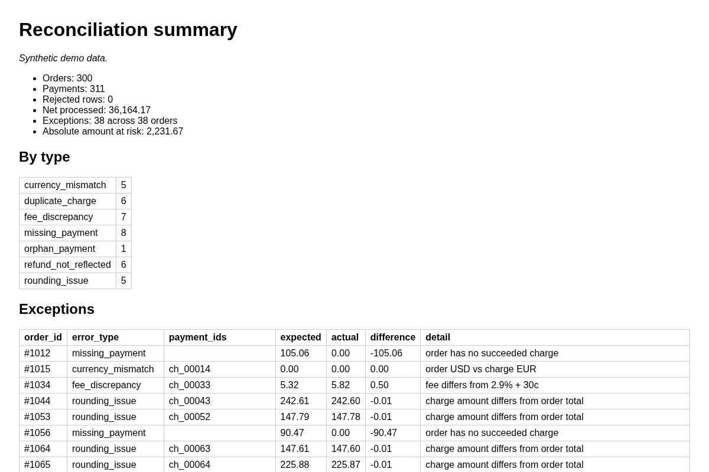
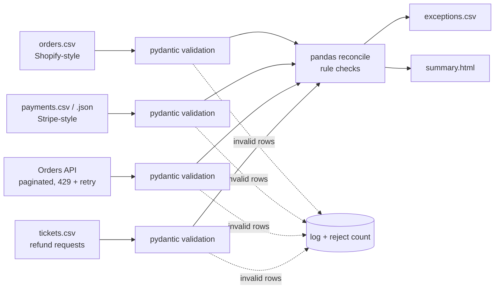

# Multi-Source Payment Reconciliation ETL


**[Sample report (live)](https://alfiochoa.github.io/payment-reconciliation-pipeline/)** — the generated `summary.html`, hosted on GitHub Pages (synthetic data).

A small **multi-source ETL** that reconciles four inputs and produces an exceptions report (`exceptions.csv` + `summary.html`):

1. **Payment processor export** (Stripe-style balance transactions, CSV/JSON)
2. **Store orders export** (Shopify-style CSV)
3. **Orders API** (Shopify-style REST, paginated via `Link` headers, with `429`/`Retry-After` retry handling; a local mock server is included)
4. **Refund / support tickets** (CSV)

> **All data in this repo is synthetic.** It is produced by a seeded generator; no real customers, orders or processor accounts are involved.



## Problem

Store owners routinely find that payouts don't match orders: a charge never arrived, a customer was charged twice, a refund was issued in the processor but not in the shop, fees look wrong, or a one-cent rounding gap shows up. Finding these by hand in spreadsheets is slow and error-prone. This tool does it deterministically and explains each exception.

## Architecture



| File | Role |
|---|---|
| `recon/models.py` | Pydantic schemas (money as integer cents) |
| `recon/api.py` | Mock orders API server + client (pagination, retry/backoff) |
| `recon/generate.py` | Seeded synthetic data for all sources + ground-truth `injected_errors.csv` |
| `recon/reconcile.py` | Load/validate + all detection rules |
| `recon/report.py` | CSV + HTML output |
| `recon/cli.py` | `generate`, `serve-mock` and `run` commands |
| `recon/demo.py` | Logic behind the web demo (default, generated or uploaded data; proof against the injected errors) |
| `streamlit_app.py` | The web demo: exceptions, proof, validation and how it works |

## Run it

```bash
pip install -r requirements-dev.txt   # runtime (pandas, pydantic, streamlit) + pytest
python -m recon generate            # -> data/: orders.csv, payments.csv, orders_api.json, tickets.csv, injected_errors.csv
python -m recon serve-mock &        # mock Shopify orders API on :8765 (every 3rd request is a 429)
python -m recon run --api-url http://127.0.0.1:8765 --tickets data/tickets.csv   # -> out/exceptions.csv, out/summary.html
python -m pytest -q
```

Or in one step: `make demo` (generates data, starts the mock API, runs the reconciliation, stops the mock). Design rationale: [docs/DESIGN.md](docs/DESIGN.md).

Options: `generate --orders 300 --seed 42 --out data`, `run --orders … --payments … --out out` (payments may be `.json`). `--api-url` and `--tickets` are optional; without them only the processor-vs-orders checks run.

**Idempotent:** reports contain no timestamps and rows are sorted, so re-running on the same input gives byte-identical output (tested). API results are sorted before use, so retries and page order don't change output. Invalid rows are rejected and logged, never silently dropped.

## Web demo

`streamlit run streamlit_app.py` opens an interactive demo of the same code (no mock server needed: it reads the generated orders API snapshot):

- **Exceptions:** the findings by type, filterable, with `exceptions.csv` and `summary.html` to download.
- **Proof:** what the pipeline found against the errors the generator injected (46 of 46 on the default data, no false positives).
- **Validation:** tick "Add 5 deliberately broken rows" and watch them being rejected and counted instead of dropped.
- Data from the default set (300 orders, seed 42), a generator (orders and seed of your choice) or your own CSV files (5 MB and 20,000 rows per file; processed in memory and deleted, use fake data only).

## Checks and injected errors

The generator injects a known number of each error (documented in `recon/generate.py` and written to `data/injected_errors.csv`), and the tests assert that every one is detected with no false positives.

| Check | Rule | Injected | Detected |
|---|---|---|---|
| `missing_payment` | non-cancelled order with no succeeded charge | 8 | 8 |
| `duplicate_charge` | >1 succeeded charge for one order | 6 | 6 |
| `fee_discrepancy` | fee ≠ 2.9% + 30¢ (±1¢) | 7 | 7 |
| `refund_not_reflected` | processor refunds > order's `refunded_amount` | 6 | 6 |
| `currency_mismatch` | charge currency ≠ order currency | 5 | 5 |
| `rounding_issue` | amount differs from order total by ≤2¢ (larger → `amount_mismatch`) | 5 | 5 |
| `orphan_payment` | charge referencing an unknown order | 1 | 1 |
| `source_drift` | orders CSV and orders API disagree on total, status, currency or refunded amount | 4 | 4 |
| `refund_ticket_unprocessed` | approved refund ticket with no matching processor refund | 4 | 4 |

Default demo (300 orders, 311 payment rows, 23 tickets, seed 42): **46 exceptions, 46 injected, 46 found.** Denied/open tickets and legitimately refunded orders are included as noise and correctly produce no exceptions.

## Sample output

One row per error type from `out/exceptions.csv` (amounts in currency units; the full run also writes `out/summary.html` with totals and all 46 rows):

| order_id | error_type | payment_ids | expected | actual | difference | detail |
|---|---|---|---|---|---|---|
| #1005 | refund_ticket_unprocessed |  | 24.71 | 0.00 | -24.71 | approved ticket T0015 has no matching processor refund |
| #1012 | missing_payment |  | 105.06 | 0.00 | -105.06 | order has no succeeded charge |
| #1015 | currency_mismatch | ch_00014 | 0.00 | 0.00 | 0.00 | order USD vs charge EUR |
| #1034 | fee_discrepancy | ch_00033 | 5.32 | 5.82 | 0.50 | fee differs from 2.9% + 30c |
| #1044 | rounding_issue | ch_00043 | 242.61 | 242.60 | -0.01 | charge amount differs from order total |
| #1069 | duplicate_charge | ch_00068;chdup_00068 | 27.63 | 55.26 | 27.63 | 2 charges for one order |
| #1095 | source_drift |  | 124.89 | 129.89 | 5.00 | orders CSV vs API differ: total |
| #1112 | refund_not_reflected | re_00111 | 128.34 | 0.00 | -128.34 | processor refunded more than order records (expected=processor, actual=order) |
| #9999 | orphan_payment | ch_orphan1 | 0.00 | 42.00 | 42.00 | charge references unknown order |

## Limitations

- Matching is by `order_id` in charge metadata; no fuzzy matching or payout/bank-deposit level grouping.
- Fee rule is a single flat model (2.9% + 30¢); real fees vary by card type, region and currency conversion.
- The orders API is a local mock (no real Shopify credentials or network); the client handles `Link` pagination and `429`/5xx retry, not OAuth.
- Tickets are matched to refunds by order and total amount only.
- Single currency assumed per order; no FX conversion.
- Partial refunds are compared as totals, not individually matched.
- Synthetic data is cleaner than real exports; real-world column mapping would need an adapter.

## License

MIT — see [LICENSE](LICENSE).
