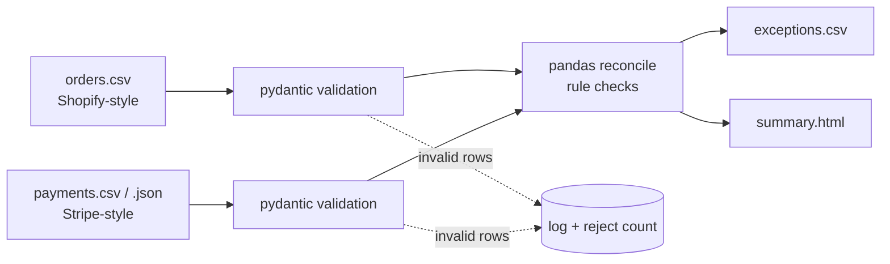

# Payment Reconciliation Pipeline


A small ETL pipeline that reconciles a **payment processor export** (Stripe-style balance transactions) against **store orders** (Shopify-style) and produces an exceptions report (`exceptions.csv` + `summary.html`).

> **All data in this repo is synthetic.** It is produced by a seeded generator; no real customers, orders or processor accounts are involved.

## Problem

Store owners routinely find that payouts don't match orders: a charge never arrived, a customer was charged twice, a refund was issued in the processor but not in the shop, fees look wrong, or a one-cent rounding gap shows up. Finding these by hand in spreadsheets is slow and error-prone. This tool does it deterministically and explains each exception.

## Architecture



| File | Role |
|---|---|
| `recon/models.py` | Pydantic schemas (money as integer cents) |
| `recon/generate.py` | Seeded synthetic data + ground-truth `injected_errors.csv` |
| `recon/reconcile.py` | Load/validate + all detection rules |
| `recon/report.py` | CSV + HTML output |
| `recon/cli.py` | `generate` and `run` commands |

## Run it

```bash
pip install -r requirements.txt
python -m recon generate            # -> data/orders.csv, payments.csv, injected_errors.csv
python -m recon run                 # -> out/exceptions.csv, out/summary.html
python -m pytest -q
```

Options: `generate --orders 300 --seed 42 --out data`, `run --orders … --payments … --out out` (payments may be `.json`).

**Idempotent:** reports contain no timestamps and rows are sorted, so re-running on the same input gives byte-identical output (tested). Invalid rows are rejected and logged, never silently dropped.

## Checks and injected errors

The generator injects a known number of each error (documented in `recon/generate.py` and written to `data/injected_errors.csv`), and the tests assert that every one is detected with no false positives.

| Check | Rule | Injected | Detected |
|---|---|---|---|
| `missing_payment` | non-cancelled order with no succeeded charge | 8 | 8 |
| `duplicate_charge` | >1 succeeded charge for one order | 6 | 6 |
| `fee_discrepancy` | fee ≠ 2.9% + 30¢ (±1¢) | 7 | 7 |
| `refund_not_reflected` | processor refunds > order's `refunded_amount` | 6 | 6 |
| `currency_mismatch` | charge currency ≠ order currency | 5 | 5 |
| `rounding_issue` | amount differs from order total by ≤2¢ (larger → `amount_mismatch`) | 5 | 5 |
| `orphan_payment` | charge referencing an unknown order | 1 | 1 |

Default demo (300 orders, 311 payment rows, seed 42): **38 exceptions, 38 injected, 38 found.**

## Sample output

One row per error type from `out/exceptions.csv` (amounts in currency units; the full run also writes `out/summary.html` with totals and all 38 rows):

| order_id | error_type | payment_ids | expected | actual | difference | detail |
|---|---|---|---|---|---|---|
| #1012 | missing_payment |  | 105.06 | 0.00 | -105.06 | order has no succeeded charge |
| #1015 | currency_mismatch | ch_00014 | 0.00 | 0.00 | 0.00 | order USD vs charge EUR |
| #1034 | fee_discrepancy | ch_00033 | 5.32 | 5.82 | 0.50 | fee differs from 2.9% + 30c |
| #1044 | rounding_issue | ch_00043 | 242.61 | 242.60 | -0.01 | charge amount differs from order total |
| #1069 | duplicate_charge | ch_00068;chdup_00068 | 27.63 | 55.26 | 27.63 | 2 charges for one order |
| #1112 | refund_not_reflected | re_00111 | 128.34 | 0.00 | -128.34 | processor refunded more than order records (expected=processor, actual=order) |
| #9999 | orphan_payment | ch_orphan1 | 0.00 | 42.00 | 42.00 | charge references unknown order |

## Limitations

- Matching is by `order_id` in charge metadata; no fuzzy matching or payout/bank-deposit level grouping.
- Fee rule is a single flat model (2.9% + 30¢); real fees vary by card type, region and currency conversion.
- Single currency assumed per order; no FX conversion.
- Partial refunds are compared as totals, not individually matched.
- Synthetic data is cleaner than real exports; real-world column mapping would need an adapter.
